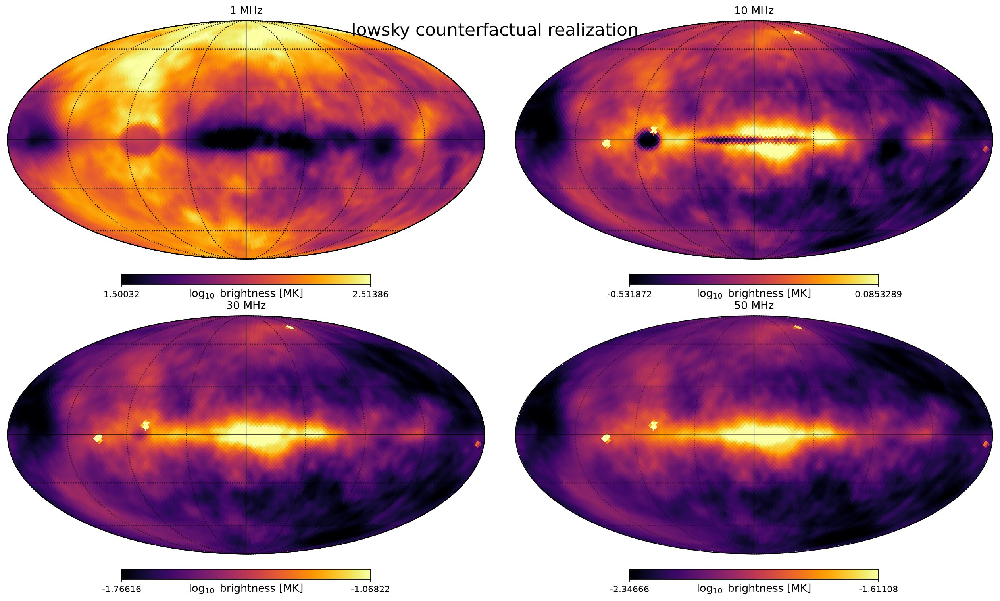

# lowsky

`lowsky` makes physics-based, counterfactual low-frequency skies. It models
the Milky Way in three dimensions instead of copying residual pixels from
Haslam or ULSA.



The 1 MHz morphology is especially prior-sensitive because even modest ionized
filaments become optically thick; isolated dark patches are not robust pixels.

## What is in the model?

The sky combines a smooth Galactic background, a small set of extended
objects, and bright point sources. In the Milky-Way-conditioned realization:

| Component | Representation |
|---|---|
| **Bright sources** | Cas A, Cyg A, Tau A, and Vir A as analytic point-source `a_lm` coefficients, with flux spectra and low-frequency turnover. |
| **Galactic synchrotron** | A smooth disk with approximate spiral arms and a central bar, plus correlated texture. |
| **Radio loops** | Five broad emitting shells representing Loop I S1/S2 and Loops II–IV, with broken-power-law spectra. |
| **Local ionized structures** | A Gaussian Gum blob, two Orion–Eridanus interfaces, a Gaussian Cygnus complex, and a Local Bubble cavity. |
| **Diffuse absorbing gas** | NE2001-inspired thick/thin disks, arms, and Galactic center, represented through effective emission measure. |
| **Radio background** | An initially isotropic power-law background, attenuated through the Galaxy. |

Free-free absorption is integrated along each line of sight, so foreground
gas attenuates emission behind it and contributes its own thermal emission.
Unresolved local screens have partial covering. Extended emission is
transformed into spherical harmonics; point sources have analytic harmonics.
The usual 2-degree-beam maps are diagnostic views of those components.

**What is fitted?** The physical realization's overall emissivity, spectral
offset, and emission-measure scale are tuned to ULSA's mean spectrum. Cas A's
normalization and turnover are now calibrated to its 2023.5 fitted peak.
Most object geometries and remaining spectra are prescribed from literature
or sampled from stated priors, rather than jointly fitted to all measurements.

A separate **survey-calibrated diffuse map** fits 48 broad Gaussian basis
functions at 10.03, 22, and 45 MHz to rescale the volume synchrotron and radio
background together. It preserves shells and absorption physics. This is an
empirical brightness correction; comparisons with those surveys are calibration
checks. Outside 10.03–45 MHz its correction is extrapolated. This map retains
the saved historical point sources and is not yet a unified harmonic product
with the updated Cas A prescription.

The design rule is to keep geometry simple and fit a small number of amplitudes,
spectral parameters, and optical depths where measurements constrain them.
See the [model inventory](docs/model_inventory.md) for implementation details
and the distinction between fitted parameters and prescribed structure.

## Install

Python 3.12 is required.

```bash
pip install "lowsky @ git+https://github.com/lusee-night/lowsky.git"
```

For development:

```bash
git clone https://github.com/lusee-night/lowsky.git
cd lowsky
uv sync --extra dev
```

## Differentiable API

`generate_sky` is the main package output. It is written entirely with JAX and
returns brightness temperature in kelvin with shape `(frequency, pixel)`.

```python
import jax
import jax.numpy as jnp

from lowsky import SkyConfig, SkyParameters, generate_sky, prepare_sky_inputs

# Geometry, seeded random fields, and catalogs are prepared outside the JAX graph.
inputs = prepare_sky_inputs(
    SkyConfig(nside=32, ray_oversample=1, sky_mode="ours", seed=20260901)
)
parameters = SkyParameters(
    emissivity_scale=1.0,
    emission_measure_scale=1.0,
    spectral_index_offset=0.0,
    synchrotron_fluctuation_sigma=0.28,
    emission_measure_fluctuation_sigma=0.32,
    spectral_index_fluctuation_sigma=0.055,
    synchrotron_spectral_curvature=0.0,
    local_shell_scale=1.0,
    local_shell_spectral_index_offset=0.0,
)

frequencies_mhz = jnp.array([1.0, 10.0, 30.0, 50.0])
sky_k = jax.jit(generate_sky)(frequencies_mhz, inputs, parameters)
```

`SkyInputs` and `SkyParameters` are JAX pytrees. The output can be used with
`jax.jit`, `jax.grad`, `jax.jacfwd`, and `jax.vmap`. Use
`generate_sky_components` when individual physical components are needed.
The setup step fixes geometry, catalogs, and unit random fields from `seed`;
the amplitudes of those fields and the synchrotron spectral parameters remain
continuous `SkyParameters`, so one realization can be optimized or sampled
without rerunning setup.

## ULSA drop-in file

Download the calibrated 1--50 MHz NSIDE-32 replacement from the
[latest release](https://github.com/lusee-night/lowsky/releases/latest/download/lowsky_32.fits),
or generate a new realization locally without reading the mounted ULSA
artifact:

```bash
uv run python examples/export_ulsa_dropin.py \
  --sky-mode ours \
  --output lowsky_32.fits
```

The writer enforces the LuSEEpy contract: one float64 primary HDU containing
50 Galactic RING-ordered NSIDE-32 maps for 1–50 MHz, with the original ULSA
header layout.

## Full pipeline

The calibrated pipeline compares a realization with an external ULSA reference,
creates diagnostic FITS maps, and saves canonical un-beamed harmonic products:

```bash
lowsky-generate \
  --mounted-ulsa /path/to/ULSA_32_ddi_smooth.fits \
  --sky-mode ours \
  --output-dir lowsky-output
```

Extended components are generated on the higher-resolution ray grid and then
transformed to spherical harmonics. Cas A, Cyg A, Tau A, and Vir A are inserted
as analytic band-limited delta functions. A beam is applied only to diagnostic
maps.

Additional examples:

```bash
uv run python examples/plot_frequency_skies.py lowsky-output/counterfactual_ulsa_nside32_1_50mhz.fits
uv run python examples/plot_harmonic_power.py --help
uv run python examples/validate_feature_fidelity.py --help
```

To test blind A-team spectral recovery over one LuSEE lunar night without the
receiver/electrical forward model, beam-convolve the canonical source-free and
source-only harmonics into separate waterfalls:

```bash
uv run python examples/one_night_source_separation.py \
  lowsky-output/counterfactual_ulsa_harmonic.npz
```

This uses the generated, validated four-port response
``/local/zack/receive_matrix/lusee_bgl_v16_response_v3.fits`` (or the file
passed with ``--response-file``) directly. Its port-specific complex effective
lengths, mutual impedance, layered-regolith/lander response, and JFET receiver
loading produce all 4 auto-power plus 6 complex cross-power products (16 real
channels); no single-port beam rotations are synthesized. The estimator uses
known source positions and an independent low-order temporal Fourier nuisance
model for each channel, but never uses the source-free waterfall in the fit.
Moon and antenna thermal emission are disabled so the saved diffuse-only and
source-only component waterfalls are strictly additive. The default
``lmax=179`` is the native harmonic ceiling of the V16 response and preserves
the modeled lunar-horizon edge at approximately its one-degree grid scale.

Validation notebooks are in [`notebooks/`](notebooks/), including the
[`diffuse versus point-source power-spectrum plot`](notebooks/diffuse_vs_point_sources.ipynb).
The diffuse morphology
has been resolution-validated through `ell = 64`; higher multipoles are retained
but should not be interpreted as converged small-scale structure.

## Scope

This is a controlled simulator, not an observational survey. It uses ULSA’s
radiative-transfer ingredients and global calibration while deliberately
avoiding a Haslam residual template. See [`references/`](references/) for the
physical anchors and literature notes.

## Observational evidence and comparison plots

The [Cas A calibration](analysis/constraints-20261013/calibration/cas_a/README.md)
sets the pipeline source prescription to the 2023.5 fitted turnover
(21.5 MHz, 29.88 kJy), conditional on the saved foreground and spectral slope.
The [survey-conditioned diffuse realization](analysis/constraints-20261013/calibration/diffuse_survey_conditioned/README.md)
is a separate empirical map product; generate it with
[`examples/calibrate_diffuse_surveys.py`](examples/calibrate_diffuse_surveys.py).
Its manifest records fitted coefficients, spatial-check residuals, and input
hashes. Physical defaults and original saved simulations are preserved.
Earlier rejected physical-parameter trials remain in the
[diagnostic record](analysis/constraints-20261013/calibration/diffuse/README.md).

The [full evidence index](evidence/README.md) brings together the historical
spectra, modern spacecraft measurements, radio surveys, HII-region data, and
object-specific constraints gathered in October 2026. It records measurement
definitions, calibration ancestry, derived quantities, duplicate entries, and
the work needed before each dataset can be compared with lowsky. An index entry
does not imply an independent measurement or a successful model validation.

From a source checkout:

```bash
JAX_PLATFORMS=cpu uv run python -m lowsky.evidence summary
JAX_PLATFORMS=cpu uv run python -m lowsky.evidence list
uv run python examples/compare_evidence.py
```

The comparison command uses the locally saved
`outputs_our_sky_gum_gaussian_final/` realization and the acquired survey maps;
these generated/binary files are not distributed in Git. Each plot records
its inputs and hashes. See the [comparison guide](docs/evidence_comparisons.md)
for input requirements, commands and interpretation, including why the existing
realization is an illustrative baseline rather than a newly calibrated fit.

The figures show the usable overlap of model and data, not a certified region
of correctness. The saved model covers 1–50 MHz, with documented diffuse
angular convergence through ell=64. Observation operators, calibration
uncertainties and source epochs impose further limits. Discrepancies remain
visible rather than being removed by selecting only agreeing observations.
