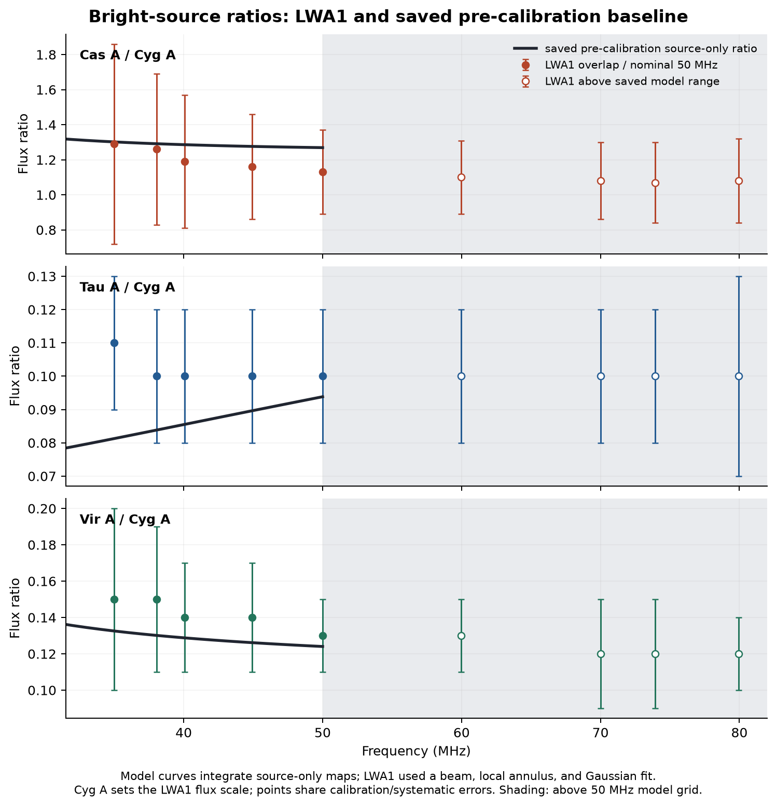
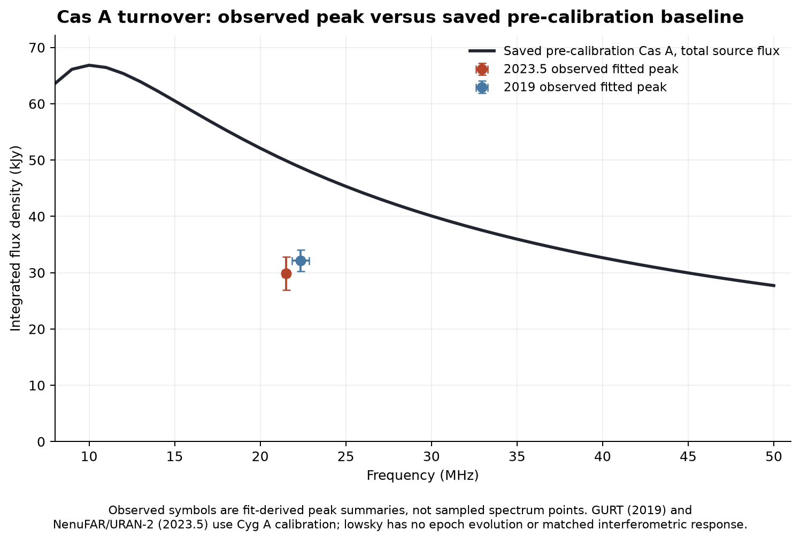
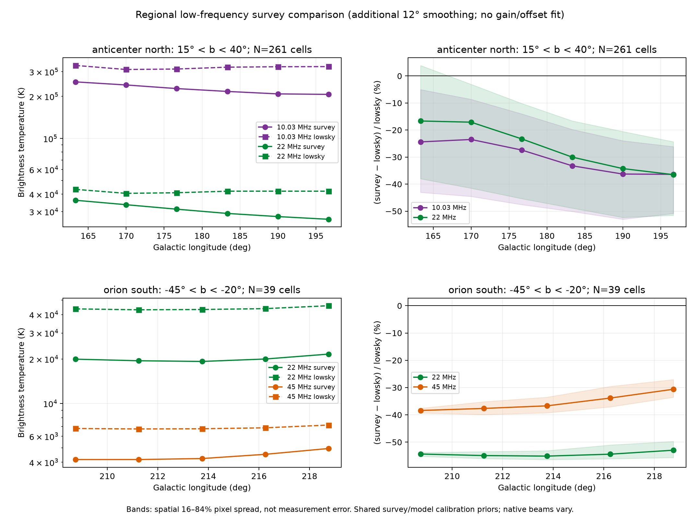

# Comparing lowsky with the full evidence index

The [evidence inventory](../evidence/README.md) includes every gathered family of data, including those that cannot yet support a direct plot. It separates measurements, derived fits, calibration models and contextual literature. The figures below are bounded diagnostic comparisons; they do not define a validated accuracy region or fit new parameters.

## Reproduce

Use the repository environment (`uv sync --extra dev`), then:

```bash
uv run python examples/compare_evidence.py
# Or independently:
uv run python examples/compare_bright_sources.py --output-dir /path/to/source-plots
uv run python examples/compare_radio_regions.py --output-dir /path/to/region-plots
```

The runner uses one CPU thread for small HEALPix operations. It records completion only after both scripts succeed. The default output is `analysis/constraints-20261013/comparisons/`; scripts resolve default input paths relative to the checkout, independent of the working directory. Missing artifacts are errors, not silently replaced by another realization.

Inputs are the existing `outputs_our_sky_gum_gaussian_final/` products, the numerical evidence JSON files under `analysis/constraints-20261013/`, and the downloaded maps under `radio_surveys/data/`. FITS and NPZ files are ignored by Git; source URLs and hashes are in the evidence manifests. The saved model's generating revision is unverified. To compare a new run, use each script's artifact/input arguments after inspecting `--help`; do not simply relabel the old figures with the current source revision.

## Figures and interpretation

### Bright-source ratios

`bright_sources/lwa1_source_ratios.png` and `.pdf` plot measured Cas A/Cyg A, Tau A/Cyg A and Vir A/Cyg A ratios against source-only predictions. The usable frequency overlap is approximately 35–50 MHz. Above-range points are displayed as context without extending the model curve. The nominal 50-MHz observation is centred at 50.005 MHz; any evaluation at 50 MHz is explicitly recorded as an approximation, not exact frequency matching.

LWA1 extracted sources with a beam, local background annulus and Gaussian fit. Integrated source-only model flux does not reproduce that full estimator. Cyg A calibration is shared, and error bars do not constitute independent Gaussian likelihood terms. This plot cannot validate Cyg A's absolute flux scale.

### Cas A turnover

`bright_sources/cas_a_turnover.png` and `.pdf` show the existing source spectrum beside the 2019 and 2023.5 fitted peak summaries. These are derived peaks rather than sampled spectral points. Epoch evolution, resolved internal absorption, flux scale and aperture all matter; lowsky currently has no source epoch parameter. The visible discrepancy is a diagnostic, not a formal rejection statistic. The 2025 Crab shell peak is deliberately excluded from the total-source Tau A comparison because they are different observables.

### Regional diffuse spectra

The regional comparison applies the same explicit sky footprints and additional coarse smoothing to source-masked observed maps and the source-free model. It uses only valid survey coverage and the southern 45-MHz component, not the northern 46.5-MHz component under a 45-MHz label. Spatial percentile ranges describe sky variation; they are not measurement-error bars. The output JSON records frequencies, footprints, masks, smoothing, retained pixels and artifact hashes. Survey native beams, calibration/offset uncertainties and possible ULSA input reuse remain limitations.

## Evidence retained but not yet used as a direct overlay

- Historical Cane/RAE spectra require their actual beam and pointing weights. An all-sky model mean is not the same statistic.
- PSP quadrupoles require verified complex harmonic normalization, phase and intensity units; the published table has no full covariance. The coefficient table is retained in the index, but no unchecked overlay is produced.
- HII absorption at 76.2 MHz requires a line-of-sight/subgrid operator and model checks above 50 MHz.
- Gum/Orion H-alpha and radio-line constraints require beam, extinction and electron-temperature treatment; a dust boundary or a pulsar-derived density model is not a direct EM measurement.
- Loop intensity points require the published spur/background selection; their distance constraints apply to sightline material rather than shell-centre distance.
- LoDeSS is a source catalogue, not a diffuse monopole measurement. EDGES/McKay spectra require beam/time weighting and mostly lie above the current saved frequency range.

The full index prevents these measurements from being forgotten while making their readiness explicit. It also prevents repeated citations or reprinted tables from becoming duplicate likelihood points.

## Generated figure gallery

These figures use the saved baseline, with provenance in the neighboring JSON files.






